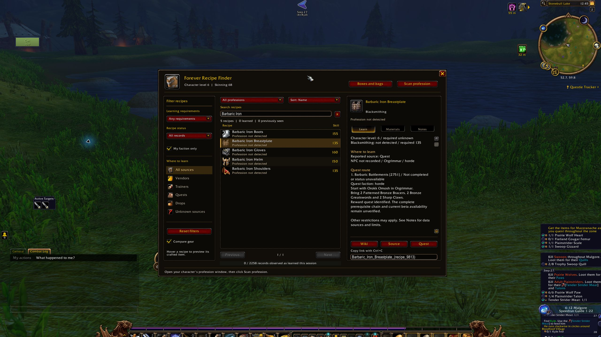

# Forever Recipe Finder

Browse recipes for WoW Forever, scan your open professions, and look up ingredients and reported learning sources. Includes tradeskill crate requirements and a bag browser.

[Download the first beta](https://github.com/DeanieBobeanie/ForeverRecipeFinder/releases/tag/v1.0.0-beta.1) · [Report a problem](https://github.com/DeanieBobeanie/ForeverRecipeFinder/issues)

## Install and open

1. Download `ForeverRecipeFinder-1.0.0-beta.1.zip` from the release assets.
2. Extract `ForeverRecipeFinder` into your Forever client's `Interface/AddOns` folder.
3. Restart the client and enable Forever Recipe Finder. Type `/frf` to open it.

Open each profession and click **Scan** to record the recipes visible to the game. Use `/frf boxes` for crates or `/frf bags` for bags. `/recipefinder` also opens the browser.

[View the crate browser](media/crates.jpg). These are screenshots from the game.

## What it does

- Searches 2,258 recipe records by profession, name and ingredients.
- Distinguishes recipes learned in this session, previously observed recipes and recipes not yet seen.
- Shows skill requirements, reported vendors and quests, item tooltips and source notes.
- Checks carried materials against 30 tradeskill crates and lists 31 bags.

## Beta limits

Targets WoW Forever 1.60.1, interface 16001. A client recipe record does not prove that the recipe is obtainable. Some acquisition hints come from Classic/TBC and remain unverified for Forever. Missing requirements are shown as unknown.

Scans depend on the game's profession APIs and visible profession state. "Not seen" does not mean "unlearned". Open your own profession to refresh observations. Eligibility does not establish vendor stock, reputation, specialization or every quest prerequisite.

This is a separate add-on with its own saved data. If you used the earlier local ARL Forever adaptation, disable that adaptation to avoid duplicate buttons and rescan your professions here. Your old saved data is left alone.

## Credits and contributions

Inspired by [Ackis Recipe List](https://github.com/Ackis/AckisRecipeList), by Ackis, Torhal, Ressy and the ARL contributors. This is not an official ARL release. The package contains no ARL runtime, database, libraries or artwork.

Thanks to [Recipe Registry](https://github.com/colettamattia91-cloud/Recipe-Registry) for MIT-licensed learning metadata and the [WoW Forever Wiki](https://wowfwiki.com/wiki/Recipes_database) for recipe records. See [data sources](docs/data-sources.md) and [packaged notices](ForeverRecipeFinder/THIRD-PARTY-NOTICES.txt).

Bug reports, verified data corrections and pull requests are welcome. See [CONTRIBUTING.md](CONTRIBUTING.md) for checks and reporting details.
